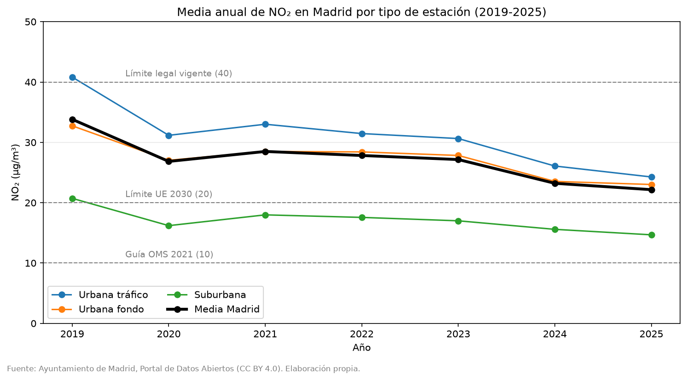
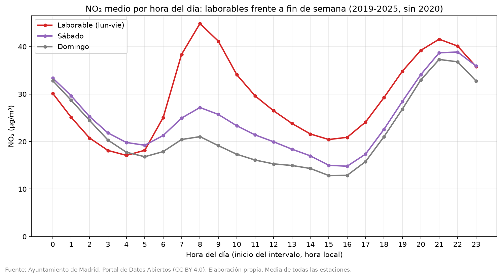
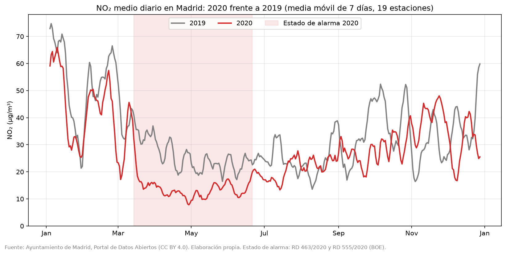

# Calidad del aire en Madrid: dióxido de nitrógeno (NO₂), 2019-2025

Análisis de los **datos abiertos horarios de calidad del aire del Ayuntamiento de Madrid** para responder
con datos a cinco preguntas sobre el dióxido de nitrógeno (NO₂), un contaminante con valores límite
fijados por la normativa europea y española.

El informe completo, con el código, los gráficos y cada decisión explicada, está en
[`notebooks/analisis.ipynb`](notebooks/analisis.ipynb).

## Preguntas

1. ¿Cómo ha evolucionado el NO₂ entre 2019 y 2025?
2. ¿Qué estaciones registran niveles más altos y más bajos?
3. ¿Hay patrones por hora del día, día de la semana o estación del año?
4. ¿Cuántas veces se superan los valores límite (UE) y recomendados (OMS)?
5. ¿Se aprecia algún cambio durante el confinamiento de 2020?

## Conclusiones principales

**1. El NO₂ ha bajado un 34,5 % entre 2019 y 2025.** En las 19 estaciones con datos completos los siete
años, la media anual pasó de 33,8 a 22,2 µg/m³. Las estaciones de tráfico son las que más bajan (−40,6 %).



**2. Plaza Elíptica es la estación más alta y El Pardo la más baja.** Plaza Elíptica (tráfico) tiene la
media anual más alta en 6 de los 7 años; El Pardo (suburbana), la más baja en todos. Todas las estaciones bajan.

**3. Hay un pico claro en la mañana de los días laborables.** A las 8h, un laborable tiene 2,1 veces más NO₂
que un domingo (44,9 frente a 21,0 µg/m³). Además, el invierno (38,9 µg/m³) casi duplica al verano (19,9 µg/m³).



**4. Desde 2022 ninguna estación supera los límites legales vigentes, pero se está lejos de los de 2030 y de
la OMS.** En 2025, 17 de 23 estaciones superan la media anual de 20 µg/m³ que exigirá la UE en 2030 y 22 de 23
superan la guía de la OMS (10 µg/m³).

**5. Durante el estado de alarma de 2020 el NO₂ fue un 48,5 % menor que en las mismas fechas de 2019.** Antes y
después del confinamiento la diferencia con 2019 fue mucho menor (−15,0 % y −11,5 %). Es una coincidencia en el
tiempo, no una relación causa-efecto demostrada.



## Datos

| | |
|---|---|
| **Fuente** | Portal de Datos Abiertos del Ayuntamiento de Madrid: [Calidad del aire. Datos horarios desde 2001](https://datos.madrid.es/dataset/201200-0-calidad-aire-horario) y [Calidad del aire. Estaciones de control](https://datos.madrid.es/dataset/212629-0-estaciones-control-aire) |
| **Licencia** | [Creative Commons Attribution 4.0 (CC BY 4.0)](https://creativecommons.org/licenses/by/4.0/legalcode.es) |
| **Periodo** | 2019 a 2025 (años completos) |
| **Volumen** | 1.434.945 horas válidas de NO₂ en 24 estaciones |

**Valores de referencia usados:**
- Legislación vigente: [Real Decreto 102/2011](https://www.boe.es/buscar/act.php?id=BOE-A-2011-1645) (Directiva 2008/50/CE).
- Límites desde 2030: [Directiva (UE) 2024/2881](https://eur-lex.europa.eu/legal-content/ES/TXT/?uri=CELEX:32024L2881).
- Recomendaciones: [Guías de calidad del aire de la OMS 2021](https://www.who.int/news-room/questions-and-answers/item/who-global-air-quality-guidelines).

Los datos **no se incluyen en el repositorio**: se descargan con un script (ver abajo).

## Cómo reproducirlo

Requisitos: Python 3.13 y Git. Los comandos son para PowerShell (Windows).

```powershell
git clone https://github.com/funki79/calidad-aire-madrid.git
cd calidad-aire-madrid

# 1. Crear y activar el entorno virtual
py -3.13 -m venv venv
.\venv\Scripts\Activate.ps1

# 2. Instalar las librerías
pip install -r requirements.txt

# 3. Descargar los datos (unos 55 MB)
python datos/descargar_datos.py

# 4. Abrir el cuaderno
jupyter notebook notebooks/analisis.ipynb
```

En macOS o Linux, el entorno se crea con `python3 -m venv venv` y se activa con `source venv/bin/activate`.

> **Nota:** si `pip install` falla con un error de ruta demasiado larga en Windows, clona el repositorio en una
> carpeta con una ruta más corta (por ejemplo, `C:\proyectos\`).

## Estructura

```
calidad-aire-madrid/
├── README.md
├── requirements.txt
├── datos/
│   └── descargar_datos.py   descarga los CSV del portal de datos abiertos
├── notebooks/
│   └── analisis.ipynb       el informe completo
├── src/
│   └── carga.py             funciones de carga y limpieza
└── img/                     gráficos exportados para este README
```

## Cómo se limpiaron los datos

1. Se leen los CSV mensuales (2019-2024) y el CSV desde 2025, y se filtra el NO₂ (magnitud 8).
2. Se pasa de una fila por día con 24 columnas de horas a **una fila por hora**.
3. Se conservan solo las horas con código de validación **`V`** (válido). Se descarta el 1,1 %.
4. Cada valor horario se etiqueta con el inicio de su intervalo (el dato `H01` corresponde a 00:00-01:00).
5. Se añaden el nombre y el tipo de cada estación.
6. Para las medias anuales solo se usan los años con al menos el **90 % de horas válidas**, y para las
   medias diarias, los días con al menos **18 horas**, como establece la normativa.

## Limitaciones

- Solo se analiza el NO₂.
- Siete combinaciones de estación y año no alcanzan el 90 % de horas válidas y no se usan en las medias anuales.
  La estación *Urb. Embajada* no tiene datos publicados en 2025.
- No se incluyen datos de tráfico ni meteorológicos: el análisis describe *cuánto* y *cuándo* cambia el NO₂,
  pero no *por qué*.
- Las medias de Madrid son medias de estaciones, no de toda la ciudad.
- El confinamiento se compara con un único año (2019). Madrid Central / Zona de Bajas Emisiones no se analiza.
- Las comparaciones con los límites legales son orientativas; la evaluación oficial corresponde a las administraciones.
- Los datos de 2025 vienen de un fichero que el Ayuntamiento actualiza cada mes (descargado en noviembre de 2026).

## Herramientas

Python 3.13 · pandas · matplotlib · Jupyter Notebook

---

*Desarrollado con ayuda de Claude Code como asistente.*

---

## English summary

Analysis of **Madrid City Council's open hourly air quality data** (2019-2025), focused on nitrogen dioxide (NO₂).

**Key findings:**
- Average NO₂ fell by **34.5 %** between 2019 and 2025 (from 33.8 to 22.2 µg/m³ across the 19 stations with complete data).
- Plaza Elíptica (traffic station) has the highest annual average in 6 of the 7 years; El Pardo (suburban) the lowest in all of them.
- Weekdays show a clear **morning peak at 8 am**: at that hour NO₂ is 2.1 times higher than on Sundays. Winter levels are almost double those of summer.
- Since 2022 no station has exceeded the current legal limits, but in 2025 17 of 23 stations were above the annual limit that the EU will require from 2030 (20 µg/m³).
- During the 2020 COVID-19 lockdown, NO₂ was **48.5 % lower** than on the same dates in 2019. This is a coincidence in time, not proven causation.

**Data:** [datos.madrid.es](https://datos.madrid.es/dataset/201200-0-calidad-aire-horario), licensed under CC BY 4.0.
**Tools:** Python, pandas, matplotlib, Jupyter. The full report (in Spanish) is in [`notebooks/analisis.ipynb`](notebooks/analisis.ipynb).

*Developed with the help of Claude Code as an assistant.*
